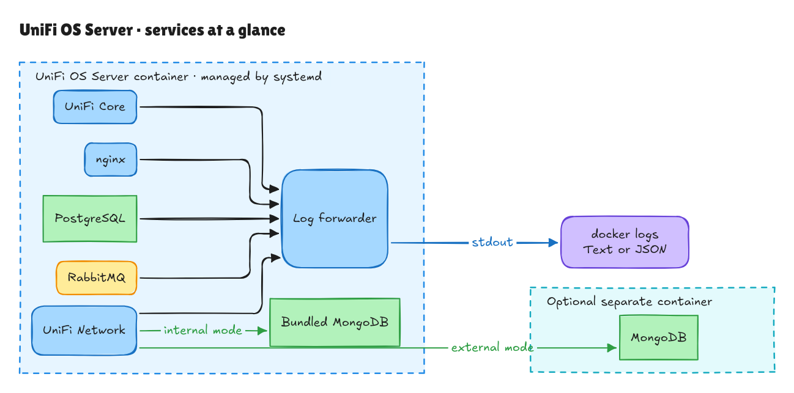

# UniFi OS Server in Docker

Run UniFi OS Server with Docker Compose using the published image from
`ghcr.io/unihosted/unifi-os-server-docker`. This project packages the image from
Ubiquiti's installer for Docker, with persistent storage and readable service logs.

## Quick Start

Save the Compose configuration below as `docker-compose.yaml`. Set `UOS_SYSTEM_IP`
to the host IP your UniFi devices can reach, then run `docker compose up -d`.
Open `https://localhost:11443` on the Docker host once the container is ready.
The example uses a separate MongoDB container; [bundled MongoDB is also available](#whats-inside).

```yaml
services:
  unifi-os-server:
    container_name: unifi-os-server
    image: ghcr.io/unihosted/unifi-os-server-docker:latest
    cgroup: host
    restart: unless-stopped
    cap_add:
      - NET_RAW
      - NET_ADMIN
    ports:
      - "8080:8080" # HTTP inform / redirect
      - "8443:8443" # UniFi Controller API
      - "8444:8444" # Secure Portal for Hotspot
      - "8880-8882:8880-8882" # Hotspot portal redirection (HTTP)
      - "10003:10003/udp" # UniFi discovery (Only needed on local network)
      - "11443:443" # UniFi Web UI (HTTPS)
      - "3478:3478/udp" # STUN used for device poking
      - "5514:5514/udp" # Syslog
      - "6789:6789" # Speed test
      - "127.0.0.1:5432:5432" # PostgreSQL (localhost only)
    extra_hosts:
      - "host.docker.internal:host-gateway"
      - "host.containers.internal:host-gateway"
    volumes:
      - /sys/fs/cgroup:/sys/fs/cgroup:rw
      - ./docker/uos:/var/lib/uosserver
      - ./docker/uos:/var/lib/unifi
      - ./docker/data/:/data
    tmpfs:
      - /run:exec
      - /run/lock
      - /tmp:exec
      - /var/log/journal
      - /var/opt/unifi/tmp:size=64m
      - /data/unifi-core/config/http
    networks:
      - unifi-os-server-network
    depends_on:
      - unifi-os-server-mongodb
    environment:
      TZ: Europe/Amsterdam
      UOS_SYSTEM_IP: "127.0.0.1"
      UOS_LOG_FORMAT: "text" # Default; set to "json" for structured log collectors.
      MONGO_INTERNAL: "false" # Defaults to false → uses the external MongoDB service below.
      # Set to "true" and remove the unifi-os-server-mongodb service + depends_on
      # to let the UniFi Network App run its own mongod (port 27117).

  unifi-os-server-mongodb:
    container_name: unifi-os-server-mongodb
    image: mongo:4.4
    networks:
      - unifi-os-server-network
    volumes:
      - ./docker/mongodb:/data/db

networks:
  unifi-os-server-network:
```

## What's inside



The main container runs UniFi Core, UniFi Network, nginx, PostgreSQL, RabbitMQ,
and supporting services under systemd. Arrows to the log forwarder show log
collection; other service connections are omitted for clarity.

MongoDB can run inside the main container or in an optional separate container.
The `MONGO_INTERNAL` environment variable selects the mode: `"false"` (default)
uses external MongoDB, as in the Compose example; `"true"` uses UniFi Network's
bundled MongoDB. For bundled MongoDB, remove the `unifi-os-server-mongodb` service
and its `depends_on` entry.

## Container logs

Several services run inside this image, each with its own log format. The log
forwarder brings their output together with consistent timestamps, service names,
and severity so you can quickly see what is happening.

Human-readable logs are the default. View them with:

```sh
docker logs -f unifi-os-server
```

```text
2026-11-03T07:24:15.277999Z [postgresql] INFO: Started PostgreSQL Cluster 14-main.
2026-11-03T07:24:15.308Z [uos-entrypoint] INFO: PostgreSQL: exposed on port 5432
```

For a log collector, set `UOS_LOG_FORMAT: "json"` in the service's environment
and apply the change with `docker compose up -d`. Each output line is a JSON
record with `timestamp`, `service`, `level`, `message`, and additional context.
Set it back to `"text"` for readable output.

See the [logging reference](docs/logging.md) for JSON fields, collector examples,
filtering, and log-size limits.

## Patched CVEs

For releases that bundle Node 24, the image includes the following runtime patch
on amd64 and arm64. Older releases retain their Node 22 application runtime.

| CVE | Node.js upgrade | Fix | Status |
| --- | --- | --- | --- |
| [CVE-2026-111497 (Node2Shell)](https://nodejs.org/en/blog/release/v24.22.1/) | 24.8.0 → 24.22.1 | [PR #17](https://github.com/unihosted/unifi-os-server-docker/pull/17) | [Issue #19 — completed](https://github.com/unihosted/unifi-os-server-docker/issues/19) |

See the [Node.js security patch notes](docs/building.md#nodejs-security-patch)
for verification and package update caveats.

## About this project

At UniHosted, we wanted to run UniFi OS Server alongside our other Docker
services. We package the OCI image from Ubiquiti's installer so it can run with
Docker Compose, and share the build process in this repository.

For contributors, the [build and maintenance notes](docs/building.md) cover
supported versions, publishing, and the included Node.js security patch. The
[editable service diagram](docs/images/services.excalidraw) can be opened in Excalidraw.

---

This project is not affiliated with, endorsed by, or supported by Ubiquiti Inc.
All trademarks and copyrights belong to their respective owners.
